# Embedded partition database — design specification

State: VALIDATE → HANDOFF  
Selected: **B — RocksDB per core-owned partition set**, approved by Gautam on 2026-09-20.  
**DRAFT — NOT AUTHORIZED FOR IMPLEMENTATION**  
Document revision: 1.6 (exact value-layer formats selected: deterministic CBOR, direct-key map/set plus block lists with folded change slots (amended 2026-10-05, L-R186cz), and object-scoped chunked blobs). Architecture and value-layer direction selected; runtime validation is pending.

## Read this first

**Decision:** embed the data engine, not a distributed consensus round on every local operation. rDB owns control metadata; three data replicas maintain each partition.

**Success means:** the primary and one regular secondary have buffered/applied the complete transaction. It does **not** mean fsync, all-copy persistence, or survival after arbitrary majority loss.

**Highest-risk dependency:** fenced ownership. No automatic failover is released until its clock, revocation and stale-request tests pass. A watch or CAS alone never grants safe failover.

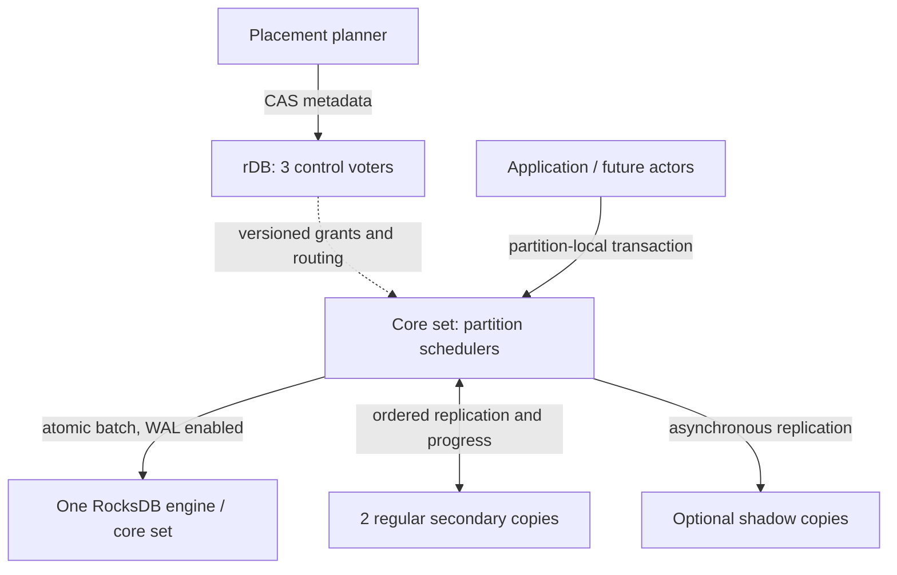

**Takeaway:** coordination, execution and replication are separate responsibilities; embedding removes a local API hop, not network replication.

Related: [decision brief](architecture-brief.md), [ADR](../ADRs/rdb/0001-core-set-partition-database.md), [developer handoff](developer-handoff.md), [validation plan](validation-plan.md).

## 1. Scope and decision ledger

### 1.1 Accepted boundaries

| ID | Decision | Basis |
|---|---|---|
| D1 | Up to 50 production machines; local deployment first; larger geography later | User requirement |
| D2 | 10–50 GB logical partitions, many per core set; one data engine per set | User sizing and selected B |
| D3 | 2,000 small transactions/sec/primary core; local p99 ≤5 ms | User target, unmeasured |
| D4 | Atomic multi-key transactions in one explicit affinity group and partition | User selected package; enables safe splitting |
| D5 | Three regular copies; primary + one regular-secondary buffered ACK | User selected package |
| D6 | After one node fails, synchronize both survivors and resume with required two-copy ACK while rebuilding; after majority loss, remain read-only until three copies return | User selections |

### 1.2 Accepted control and evolution boundaries

| ID | Decision | Basis |
|---|---|---|
| D7 | Three rDB control voters; separate data-node membership | User selected package |
| D8 | Epochs plus expiring grants and conservative fencing; fail closed without proof | User selected package; new capability required |
| D9 | Separate balancing objectives for regular copies, primaries and shadows | User requirement |
| D10 | Actor inbox/state/outbox transaction, destination idempotency/fencing required | Selected evolution boundary |
| D11 | No cross-partition transactions, no blanket exactly-once or zero-loss promise | Consequence of selected scope |
| D12 | Split by affinity-hash range; never split an affinity group | Selected package |
| D13 | Hybrid value layer: whole small values, separately stored collections, chunked large blobs | User selected on 2026-09-20 |
| D14 | Canonical logical mutations drive replication; RocksDB Merge is opt-in only for bounded, validated mutation families | User selected package; upstream research |
| D15 | Flexible documents use the selected deterministic RFC 8949 CBOR profile | User selected on 2026-09-20; encoding evidence |
| D16 | Maps/sets use direct ordered keys; lists use stable elements in bounded blocks, each change written as a small change record and folded into its block, a small element's value stored in its block (amended 2026-10-05, L-R186cz, replacing the order-statistic B+ tree; [ADR-rdb-0016](../ADRs/rdb/0016-ordered-lists.md) decision 1) | User selected on 2026-09-20 |
| D17 | Large blobs use object-scoped immutable chunks with no cross-object deduplication in v1 | User selected on 2026-09-20 |

All MUST/SHALL statements below are proposed implementation contracts under the accepted architecture. Tuning values are initial defaults to validate, not observed guarantees.

## 2. Terms and units

| Term | Meaning |
|---|---|
| Partition | Logical hash range, recovery lineage, ordered transaction history and replica placement unit |
| Affinity group | Application-selected stable ID; all atomically related keys share it; hash selects partition |
| Core set | Local scheduler owning multiple primary/secondary partitions and one data engine; not a replication unit |
| Regular replica | Primary-eligible copy on a distinct machine; counts toward default protection |
| Shadow | Never-primary asynchronous copy; does not replace a regular copy in ACK or readiness predicates |
| Control voter | rDB Raft member, independent of which partitions the machine stores |
| Recovery generation | Monotonic partition history incarnation; callers use it to detect possible rollback |

GB means decimal bytes for planning. Partition size counts live logical key/value bytes; placement also accounts for actual disk bytes, retained history and compaction space. The 50 GB value is not an enforceable cap for a single indivisible group.

## 3. Components and embedding

### 3.1 Who decides, owns and serves

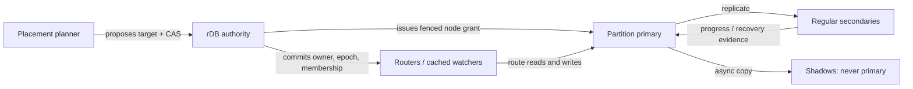

**Takeaway:** the planner proposes; rDB makes the authoritative decision; only the granted primary serves operations.

### 3.2 Runtime boundaries


| Component | Responsibility | Logical owner for future implementation |
|---|---|---|
| Embedded API/router | Routing cache, deadlines, retry identity, affinity checking | API module owner |
| Core-set executor | Partition serial queues; shard-local state; bounded IO dispatch | Runtime module owner |
| Storage adapter | Atomic batches, logical history, checkpoints, prefix export/import | Storage module owner |
| Replication/recovery | Ordered append, watermarks, catch-up, lineage validation | Replication module owner |
| Control adapter | rDB metadata, grants, watches, coherent resync | Control module owner |
| Placement/lifecycle | Planner, balancing, copy changes, split/move orchestration | Placement module owner |
| Actor adapter, later | Activation gate, inbox/outbox, external-effect boundary | Actor module owner |

These are component roles, not invented staffing assignments. Implementation approval must bind people to the roles.

The process embeds the database API. A control voter may also embed rDB DirectClient; other data nodes use a cached control client/watch, not a hidden full-voter-per-node topology. Loss of the control quorum eventually stops lease-backed writes even if data replicas still communicate.

For v1 validation, exactly one core set maps to each configured primary execution core (a reserved logical CPU); SMT topology must be reported. Throughput is normalized by those configured cores, never by total machine cores or a dynamically increased set count. Set count and core count are equal in the benchmark fixture; changing that invariant requires new validation.

RocksDB calls are blocking. Submit them to bounded IO workers; do not block the core executor while waiting on network or fsync. CPU pinning applies to execution ownership; background compaction and IO thread budgets are explicitly process-wide.

## 4. Storage layout and resource budget

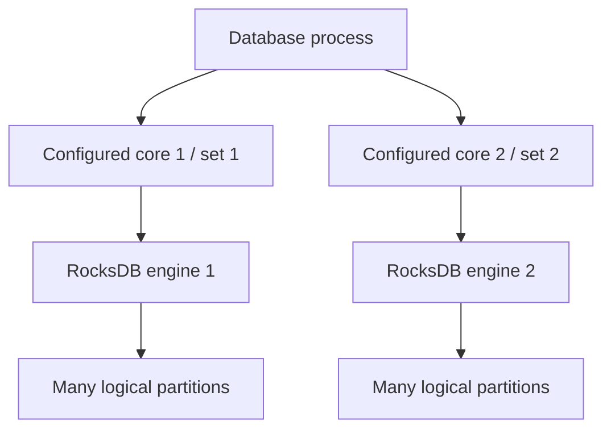

**Takeaway:** one configured primary core owns one set and one engine; partitions remain independent placement and recovery units.


### 4.1 One engine per core set

Use a fixed set of column families: `data`, `history`, `metadata`, `dedup`, `actor`. Prefix every key with an unambiguous length-delimited partition ID and generation; encode group and user keys deterministically.

One transaction WriteBatch contains its deterministic mutation list/history envelope, all user-key changes, request-result dedup entry and last-applied metadata. WAL is enabled; `sync=false` on the fast path. Never reproduce rDB's whole state-machine or consensus log as the data API.

A logical history record is retained in RocksDB as data; native engine WAL sequence numbers are not the cross-node replication identity. Core engines may mix many partitions in the physical WAL; each partition still has its own logical ordered history.

### 4.2 Initial bounded budgets

| Resource | Initial rule | Failure behavior |
|---|---|---|
| Data-engine memory | Shared cache budget ≤25% node RAM; shared memtable budget ≤15%; tune within a total ≤60% DB-process RAM envelope | Backpressure before host OOM; include native allocations in measurement |
| Local queues | Max 1,024 waiting requests/partition and 64 MiB/core set, whichever trips first | `OVERLOADED`, before admission |
| Transaction envelope | Max 255 client mutations per request, so the envelope holds at most 256 writes with the primary's one dedup write; max 1 MiB encoded envelope bytes; fixed v1 defaults. The primary checks both before it writes. No two writes (`Put` or `Delete`) in one request name the same key; conditions are not counted | `INVALID_ARGUMENT` before mutation |
| API request limits | `rdb_api::Db` checks four limits before anything is compiled, sent or read (M9 S5): an object id of at most 1,024 bytes, on every write and read; a map key or set member of at most 1,024 bytes (text counts UTF-8 bytes), in any element op and as a members page's `after`; at most 255 ops in one change and 255 puts in one transaction; a page (members or list items) of at most 1,000 items. **The page cap counts items, not bytes**: one page can still be large. A page byte cap and a range read's length cap are carried to M10. M10's wire must call the same checks (ADR-rdb-0013 decision 11) | `INVALID_ARGUMENT` before compile; nothing is sent; the detail ends `request R not sent` or `not read` |
| Core-set count | One per configured primary execution core, not every logical hardware thread by default | Record actual map in benchmark/configuration |
| Disk headroom | Stop new placements at 70% allocated capacity; warning at 80%; stop new writes at 90% | Preserve room for compaction/recovery; alert before rejection |
| Background moves | At most one inbound and one outbound bulk transfer/node; initial cap 10% measured disk/network sustainable bandwidth | Foreground budget wins; pause transfers on p99 breach |

Budgets are tuning defaults. A target failing within these limits requires measured revision, not hidden resource expansion.

### 4.3 Selected hybrid value layer

The public value model supports four logical families:

| Family | Logical contract | Initial physical form |
|---|---|---|
| Binary | Opaque application bytes | Whole encoded value when inline; manifest plus immutable chunks when large |
| Document | Flexible extended-JSON types: null, boolean, signed/unsigned integer, float, decimal, string, binary, timestamp, array and object | Canonical binary document for bounded objects |
| Typed actor state | Application schema ID and schema version plus encoded payload | Whole object or application-declared subobjects |
| Collection | Map, set or ordered list inside one actor/affinity namespace | Metadata plus independently addressed elements or bounded pages |

Every stored object has a `kind`, a format version, a logical length and an integrity digest in its stored bytes; its storage key is built from its `object_id` ([ADR-rdb-0013](../ADRs/rdb/0013-object-keys-maps-and-sets.md) decision 1) and its `object_version` is its storage record's version (the `seq` of the transaction that last wrote it), never a copy inside the bytes ([ADR-rdb-0012](../ADRs/rdb/0012-document-encoding-cbor-profile.md) decision 8). Every mutation supplies `expected_object_version` or an explicit create-if-absent condition. Unknown mandatory formats fail before mutation; decoders for retained old formats remain available through migration and snapshot retention.

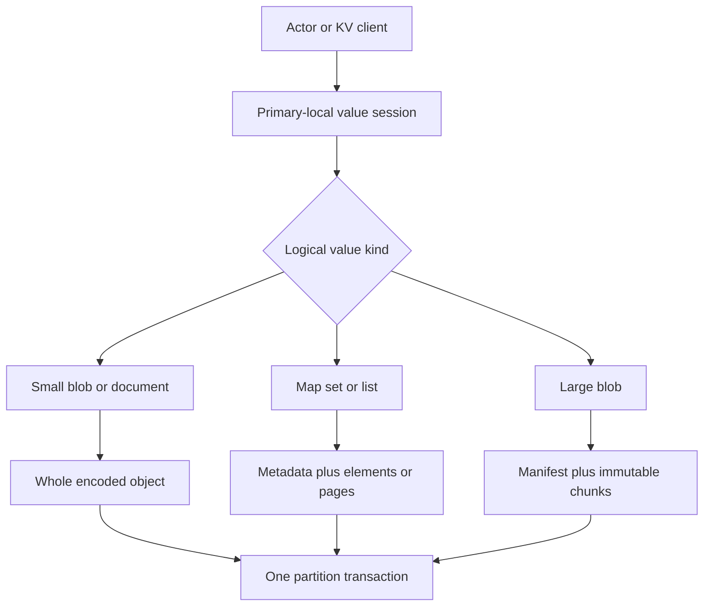

**Takeaway:** callers see one versioned value API; storage shape changes by value kind so small values stay simple and large collections avoid whole-value rewrites.

#### 4.3.1 Size classes and large blobs

Initial validation defaults are: preferred whole-document size at most 256 KiB, hard inline encoded value limit 1 MiB, blob chunks of at most 1,044,480 bytes, and at most 255 chunks per blob, so a logical blob of at most 266,342,400 bytes (254 MiB) (amended 2026-10-05, L-R186x Q2; [ADR-rdb-0014](../ADRs/rdb/0014-large-blobs-chunks-manifest-gc.md) decision 4). These are not measured guarantees. The existing 1 MiB transaction-envelope limit still applies. For a document, the 1 MiB inline limit is the stored envelope: a 40-byte header plus at most 1,048,536 bytes of canonical payload ([ADR-rdb-0012](../ADRs/rdb/0012-document-encoding-cbor-profile.md) decision 7). A write must also fit that envelope, its key, the transaction's other writes and the record overhead into the 1 MiB transaction envelope, which the primary refuses before writing when it is over. For a request that writes one document, the largest payload is 1,048,576 − 275 − key length − conditions − 40 bytes, that is 1,048,261 − key length − conditions: 275 bytes of record framing as the primary measures it (header, fixed fields, the dedup write and the write's own framing), one byte per condition (a create carries one), and the document's 40-byte header. For an 18-byte key the largest create payload is 1,048,242 bytes ([ADR-rdb-0012](../ADRs/rdb/0012-document-encoding-cbor-profile.md) Consequences).

A large-blob upload therefore uses idempotent immutable chunk writes followed by one atomic manifest publication. Chunks are scoped to one blob object and upload/generation; v1 never shares them across objects or generations. Every chunk has a SHA-256 digest of its bytes in the manifest, which is its plaintext digest, and an envelope digest over the envelope header and its bytes, which is its stored-payload checksum; in v1 the stored payload is the plaintext, and compression or encryption is a later `codec_version` (amended 2026-10-05, L-R186x Q1 and L-R186av; [ADR-rdb-0014](../ADRs/rdb/0014-large-blobs-chunks-manifest-gc.md) decisions 2 and 3). A manifest names the exact ordered indexes, lengths and digests, total length, whole-blob digest, codec and object version. Readers validate manifest and chunk digests. Aborted or replaced generations remain unreachable and are garbage-collected only after snapshot, read-session, replication, backup and rollback retention gates.

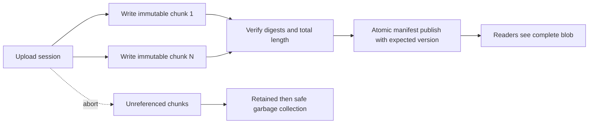

**Takeaway:** incomplete uploads are invisible; one small atomic manifest switch publishes the complete large blob.

Chunk upload uses a retry-stable `upload_id` over a separate authenticated, flow-controlled stream; chunk frames are at most 256 KiB and do not consume the transaction envelope. Rewriting one index with identical bytes succeeds; different bytes return `UPLOAD_CHUNK_CONFLICT`. Completion requires contiguous indexes and verified lengths/digests. Before manifest admission, the primary must prepare and verify all required chunks on one selected regular secondary within 5 s. Failure returns definitive `BLOB_DEPENDENCY_UNAVAILABLE` before local apply. A prepared-secondary token binds that chunk set to the manifest digest; only that secondary's matching transaction ACK counts. Publication then uses a normal transaction with `expected_object_version`; version conflict leaves the upload unreachable. Range reads resolve one manifest and fetch only intersecting chunks. Exact records, recovery and safe-floor GC are defined in the blob decision, [ADR-rdb-0014](../ADRs/rdb/0014-large-blobs-chunks-manifest-gc.md) (amended 2026-10-05, L-R186x).

#### 4.3.2 Documents and collections

V1 document mutations are key-path operations evaluated on the primary: get/set/remove field, numeric increment with declared overflow behavior, and compare-by-object-version. Arbitrary stored procedures, user callbacks and secondary-side business logic are forbidden. A document mutation either writes the new canonical whole document or uses a later validated optimization without changing the logical transaction record.

Flexible documents use `codec_id=rdb-cbor-document`, `codec_version=1`, and an rDB deterministic CBOR profile based on RFC 8949: definite lengths; UTF-8 text map keys; no duplicates; deterministic encoded-key ordering; shortest integers/lengths; finite binary64 with negative zero preserved; native byte strings; normalized decimal-fraction tag 4; registered extended-time tag 1001 with exactly epoch seconds plus optional nanoseconds; and rejection of every other tag or `undefined`. Always encoding floats as binary64 is an explicit profile deviation from RFC 8949's preferred shortest-float rule. The envelope stores the envelope format, kind, codec version, payload length, digest algorithm, digest and the canonical bytes; the object version is the storage record's version, not a field of the envelope. Resource limits are checked before commit. Unknown mandatory codec versions fail closed. Exact rules and evidence are in [the encoding decision, ADR-rdb-0012](../ADRs/rdb/0012-document-encoding-cbor-profile.md).

Maps and sets use one direct ordered record per canonical key/member. Their v1 key profile permits null, boolean, signed/unsigned integer, finite `f64`, UTF-8 string, byte string, timestamp and decimal; arrays, maps and application tags are rejected as keys. Ordering is type-first then value. Numeric types are distinct domains with no cross-type normalization. The versioned memcomparable encoding makes RocksDB byte order the public database order; exact discriminator and within-type rules, the order of the types and the record layout are in the collection decision, [ADR-rdb-0013](../ADRs/rdb/0013-object-keys-maps-and-sets.md) (decisions 3, 4 and 7).

Lists use stable 128-bit element IDs kept in order in blocks. The list's root record holds its element count, encoded byte total and an ordered index of its blocks, each with its element count. An element whose encoded value is small, initially at most 256 bytes, is stored in its block entry beside its ID; a larger one is stored in its own element record. A list created to keep every element in its own record never stores a value in a block. A change does not rewrite its block: it writes the root and one change record in one of the block's 240 reusable slots, and the primary folds the pending changes into the block when they pass 240 or a quarter of the block's bytes. A fold is an ordinary replicated write of after-images; lists do not use RocksDB Merge (D14, §4.3.4). Positional lookup opens the root and one block; a mutation writes the root and one change record, or the root and a folded block. A block over its size limit splits, the last block at its end and any other in halves; a change that cannot leave every block within the limit is refused. A block under a quarter of the limit may merge with a neighbour, and a block left with no elements is deleted unless it is the list's only block. Block size (initially 128 KiB, at most 192 KiB), the fold triggers and the 256-byte limit are write-side tuning that readers never check; the 240 slots, the 256 KiB block ceiling and at most 512 blocks per list are part of the stored format (amended 2026-10-05, L-R186cz, replacing the order-statistic B+ tree; [ADR-rdb-0016](../ADRs/rdb/0016-ordered-lists.md) decisions 1, 3 and 4). Exact records and scan tokens are defined in [ADR-rdb-0016](../ADRs/rdb/0016-ordered-lists.md).

A collection is one logical versioned object. Every collection mutation MUST condition on its current collection `object_version`; each successful logical mutation increments that version exactly once, even if several elements/pages change; the version is the `seq` of that transaction, so it rises once per transaction but not by exactly 1 ([ADR-rdb-0013](../ADRs/rdb/0013-object-keys-maps-and-sets.md) decision 8). Element records, list blocks, change records and the collection root carry internal storage revisions for corruption checks and deterministic replay; a list element stored in its block carries the collection root's revision (amended 2026-10-05, L-R186cz; [ADR-rdb-0016](../ADRs/rdb/0016-ordered-lists.md) decision 6). Those revisions are not independent public concurrency tokens in v1. Callers may additionally require target-element presence, absence, value digest or stable element ID. Deletes write a tombstone carrying the mutation sequence until dedup, snapshot and recovery retention permit removal; storage's own delete meets this, so the value layer writes no extra tombstone ([ADR-rdb-0013](../ADRs/rdb/0013-object-keys-maps-and-sets.md) decision 12). Results return the new collection version and, for list insertions, the assigned stable element ID. Therefore two concurrent mutations from the same old collection version conflict even when they touch different elements; finer-grained concurrency is deliberately deferred.

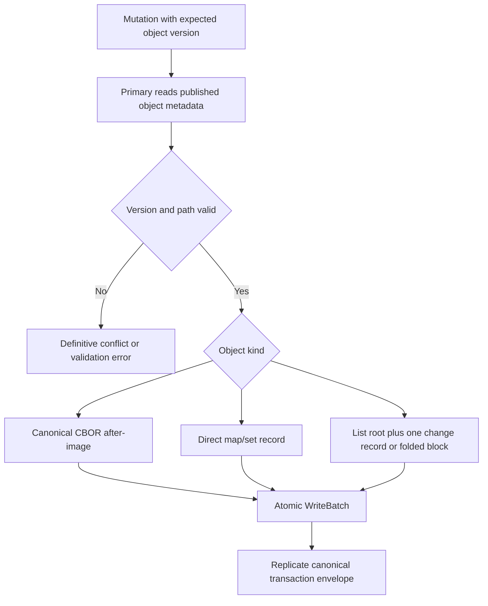

**Takeaway:** primary-local computation is allowed, but the committed result is bounded, deterministic, version-checked and atomically replayable.

#### 4.3.3 Actor-local object namespace

One actor affinity group may contain multiple independently versioned objects: root state, named maps, sets, lists, blobs, inbox, outbox and timers. They share the partition transaction boundary but not one giant serialized value. Object IDs and collection element keys remain within the same tenant and affinity prefix, so partition movement and splitting cannot separate them.

The actor runtime opens a primary-local session at one published partition prefix. It reads objects, computes changes in process, and commits one transaction containing all expected versions and mutations. No session survives authority loss, generation change, deadline expiry or actor deactivation.

#### 4.3.4 RocksDB Merge boundary

RocksDB Merge is a local physical optimization, never the replication or recovery protocol. Replicas receive the canonical logical transaction and deterministically produce the same object versions and after-images. A mutation family may use Merge only after all of these gates pass:

- exact reference materializer and deterministic ordered replay;
- property-tested partial-merge equivalence, when partial merging is enabled;
- bounded operand count, bytes, read latency and compaction memory;
- panic/exception containment and corrupt-operand quarantine;
- compatible old operand decoders across reopen, rolling upgrade, snapshot and restore;
- measured benefit over whole Put or split-object storage.

Initial candidates are counters, min/max and append of immutable-ID entries. Generic JSON path updates do not use Merge by default. The detailed upstream evidence and Rust binding limits are in [the Merge analysis](evidence/rocksdb-merge-analysis.md).

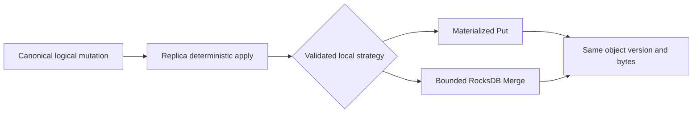

**Takeaway:** Merge may change local write cost, but it may not change the database’s visible value, version, replication or recovery semantics.

## 5. API and transaction semantics

### 5.1 Request contract

`TxnRequest` required fields: `api_version=1`, `tenant`, `affinity_id`, `client_id`, `request_id`, `expected_generation`, `deadline`, `conditions[]`, `mutations[]`. Conditions compare key/object versions or absence. Mutations include whole put/delete, document path operations, collection element/page operations and blob-manifest publication; every object mutation names its expected object version. Remote deadlines are transmitted as remaining duration, not trusted client wall-clock timestamps.

Keys MUST share tenant and affinity ID. Arbitrary user callbacks and externally held transactions are not accepted in v1. Reads/conditions and mutation construction run serially against the partition's authoritative local state.

`TxnResult` returns `partition_id`, `owner_epoch`, `generation`, `seq`, `outcome`, and `durability=BUFFERED_ON_TWO`. Result order is the partition order, not a global ordering across partitions.

### 5.2 Ordered write path

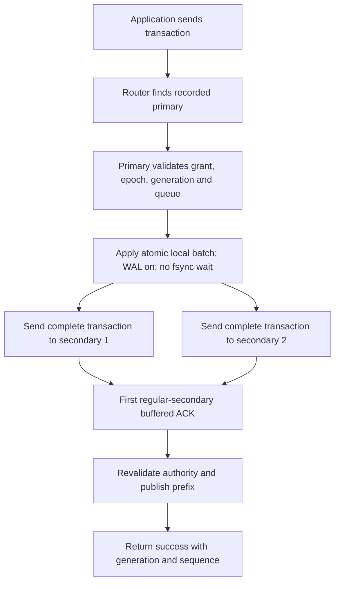

**Takeaway:** success needs one regular-secondary acknowledgement; the other copy continues concurrently and disk sync remains asynchronous.


1. Resolve affinity hash; validate route, owner grant, epoch, generation, limits and health admission.
2. Serialize at partition queue. Resolve dedup; check conditions; assign next sequence and deterministic after-images.
3. Revalidate grant/epoch at storage dispatch; cancel expired work. Apply one atomic local batch with WAL enabled in that generation’s namespace; no fsync wait. Local storage failure fences the partition.
4. Replicate the identical transaction envelope to both regular secondaries concurrently; shadows receive separately.
5. A secondary validates contiguous ancestry and epoch, applies its atomic batch, then returns `buffered_applied_seq`.
6. Recheck authority and generation; return success only after one regular-secondary ACK. Advance client-visible successful prefix before serving the next queued operation.
7. Group sync asynchronously; update verified durable watermarks only after a successful flush boundary.

Initially allow one admitted transaction in flight per partition. Other partitions in the set keep running. A single hot partition cannot be assumed to achieve 2,000 tx/sec with network waits; the normative target is per configured primary execution core.

### 5.3 Timeouts, visibility and dedup

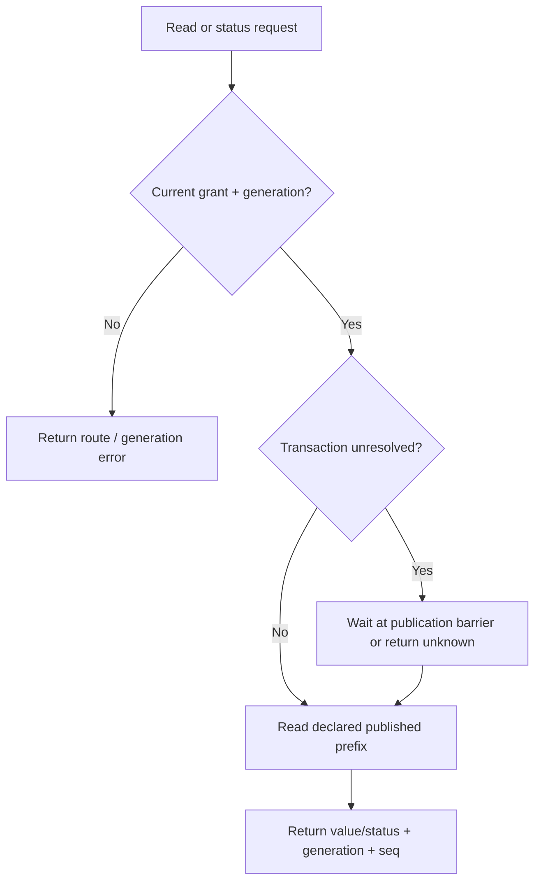

**Takeaway:** reads never expose raw locally applied bytes; every consumer sees only the declared published prefix.


After local application, timeouts or lease loss return `UNKNOWN_OUTCOME`, never definitive failure. Freeze that partition's normal read/write queue until the transaction is resolved with a replica ACK or an explicit recovery decision. No later transaction may skip the unresolved sequence.

Publication is a distinct local state transition serialized by the partition executor. Only the required ACK plus an authority recheck may publish the applied prefix; a lost client reply does not reverse publication.

All API reads, snapshot/export workers, actor readers, timers and outbox dispatchers acquire a partition publication barrier. They never read the raw prefix.

The barrier waits for the in-flight transaction or obtains an immutable snapshot at the previous published prefix. Maintenance cannot export partially published state; isolated diagnostic/recovery readers cannot produce application effects.

Within one active generation, primary reads pass the same authority gate and serial queue; they see an ordered whole-transaction prefix. Healthy secondary reads are not exposed in v1. After recovery, reads declare the new generation and may observe loss of previously acknowledged values.

Dedup key is `(tenant, client_id, request_id)` scoped to its affinity group and generation; store request digest and result atomically. Same identity with changed payload is `REQUEST_ID_REUSE`. Keep dedup entries at least 24 hours; beyond retention callers cannot infer nonexecution from absence. So a retry is deduplicated only inside the retention window: past it, a retry with the same identity is admitted as a new request and may apply again, at a new sequence, unless it names an expected generation that has since changed (clarified 2026-10-18, M9 S3; row M7A-89; [ADR-rdb-0004](../ADRs/rdb/0004-transaction-contract.md) §4).

**Amended 2026-10-22 (M10, lead rulings A-R181, A-R182): the retention window is an app option.** 24 hours stays the default. An app may set a shorter window with `DbConfig::dedup_retention` (`crates/rdb-api/src/db.rs`; its doc and `DbConfig::dedup_cap`'s give the write rate each window sustains and the memory per entry). The cost is the rule above, sooner: past the window, a resend or a status query with the same identity cannot be settled.

A retry with stale expected generation returns `GENERATION_CHANGED` before any mutation. The caller must reconcile on recovery; it must not silently retry a lost-generation transaction as a new effect. A transaction received by a replica may recover even if its client never saw success.

### 5.4 Error categories

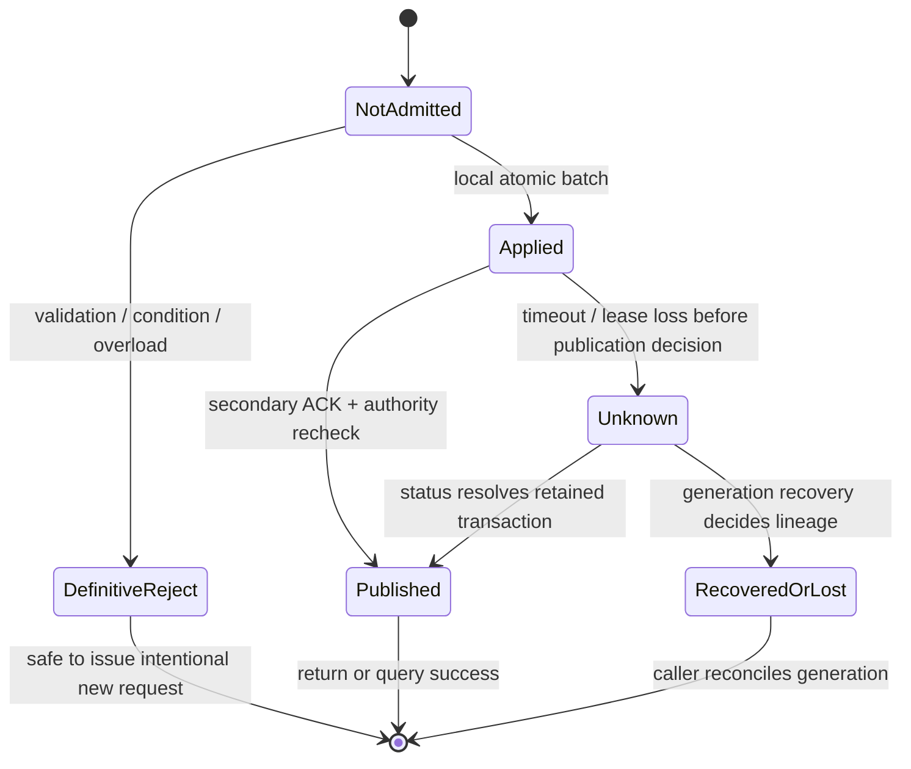

**Takeaway:** only a refusal before apply proves no mutation, and only by the submission it answers; post-apply failure is an unknown outcome resolved by status or recovery. (Reworded 2026-10-22 from "only pre-admission rejection": `OVERLOADED` and `DEADLINE_BEFORE_ADMISSION` already came from after admission and before apply.)

**Client rule (amended 2026-10-18, M9 S3, #35):** once any send of a request ID went unanswered (a timeout, a lost reply or `UNKNOWN_OUTCOME`), only a status query with the same identity settles it, and only inside the dedup retention window (§5.3). A definitive rejection of a later resend does not settle it. Admission checks run before the dedup lookup, so a resend of a request that already applied can be refused, and that answer covers the resend alone ([ADR-rdb-0004](../ADRs/rdb/0004-transaction-contract.md) §3 and §5). While a write is applied but not yet published, status answers `UNKNOWN_OUTCOME`; ask again with the same identity.


| Error | Retry rule |
|---|---|
| `NOT_PRIMARY`, `ROUTE_CHANGED` | Refresh route; retain request identity and expected generation |
| `LEASE_EXPIRED` | Retry after health/authority recovers; do not assume already-admitted request failed. Proves no mutation by this submission (amended 2026-10-24, below) |
| `RECOVERY_READ_ONLY` | Retry after health/authority recovers; do not assume already-admitted request failed |
| `PROTECTION_PAUSED` | Retry after health/authority recovers; do not assume already-admitted request failed. Proves no mutation by this submission (amended 2026-10-22, below) |
| `CONDITION_FAILED`, `CROSS_AFFINITY`, `INVALID_ARGUMENT` | Definitive rejection before mutation; caller changes request intentionally |
| `OVERLOADED`, `DEADLINE_BEFORE_ADMISSION` | Definitive no-admission; bounded jittered retry |
| `UNKNOWN_OUTCOME` | Query status with same identity; do not generate a new request ID |
| `GENERATION_CHANGED`, `REQUEST_ID_REUSE`, `UPLOAD_CHUNK_CONFLICT` | Reconcile or fail; never transparent replay; chunk conflict means the upload/index identity was reused with different bytes |
| `BLOB_DEPENDENCY_UNAVAILABLE` | Definitive pre-admission rejection; resume/repair chunk preparation and retry the same publication identity |
| `STALE_CONTINUATION` | Restart the scan at a new snapshot/version; never silently continue against changed ordering |
| `CORRUPT_BLOB`, `CORRUPT_HISTORY`, `INCOMPATIBLE_VERSION`, `STATUS_EXPIRED` | Quarantine/reject; operator or rollout action; corrupt blob streams yield no successful partial result |

**Amended 2026-10-22 (M10 D4, lead ruling A-R180): `PROTECTION_PAUSED` proves no mutation by this submission; `LEASE_EXPIRED` does not (until 2026-10-24).** Every paused refusal is made before apply: admission's L1 check, a frozen queue (including the queue drained behind a failed batch), and a local storage fence found before apply. A failed batch answers its own request `UNKNOWN_OUTCOME`, never paused. `LEASE_EXPIRED` was then also what an authority deny after apply answered, so it proved nothing (changed 2026-10-24, below). The proof covers this send only (client rule above): a resend of a request that may have applied still reports no proof to the app. `DIVERGENCE_REQUIRES_OPERATOR` is unchanged; `RECOVERY_READ_ONLY` was unchanged until 2026-10-24, below. [ADR-rdb-0004](../ADRs/rdb/0004-transaction-contract.md) §5 holds the full amendment and the rows that pin it.

**Amended 2026-10-23 (M10 S2, lead ruling A-R285): a write refused because the control quorum is lost answers `PROTECTION_PAUSED` before apply, and `LEASE_EXPIRED` after.** (After apply it is `UNKNOWN_OUTCOME` since 2026-10-24, below.) The node still holds its grant and is not fenced; it only cannot prove the grant right now (an election in the control plane, say). Before apply nothing was handed to storage, so the refusal proves no mutation. The retry rule is unchanged. `DenyReason::client_error_kind` is the one place the mapping is written.

**Amended for issue #80.** Control-quorum loss no longer refuses a write while the grant lasts, so A1 gives no `ControlUnavailable` deny at a write's or a read's checks. Writes stop at the grant's horizon with `LEASE_EXPIRED`. The mapping above stays for the reason itself.

**Amended 2026-10-24 (M10 S2, lead rulings A-R342 and A-R343): `LEASE_EXPIRED` proves no mutation by this submission.** Every `LEASE_EXPIRED` is a refusal before apply: admission's authority check, a freeze for a lost grant, the dispatch check, or a refused read. After apply, every authority deny answers `UNKNOWN_OUTCOME` instead, `ControlUnavailable` included, so the proof can never cover a batch that may have landed. The retry rule is unchanged, and the proof covers this send only (client rule above). [ADR-rdb-0004](../ADRs/rdb/0004-transaction-contract.md) §5 holds the full amendment and its rows.

**Amended 2026-10-24 (M10 S2, lead ruling A-R401 F4): `RECOVERY_READ_ONLY` proves no mutation by this submission.** Its one producer refuses before apply: admission, a frozen queue's dispatch reply, an undispatched check, or a drain of the queue. A dispatched write is never answered with it. The retry rule is unchanged, and the proof covers this send only (client rule above). [ADR-rdb-0004](../ADRs/rdb/0004-transaction-contract.md) §5 holds the full amendment and its row.

(Status 2026-10-21, M9 S6: a stored record written by a newer build answers `INCOMPATIBLE_VERSION`, not `CORRUPT_HISTORY` or `CORRUPT_BLOB`: it may be valid, and it waits for the rollout. Damage stays `CORRUPT_*`, and the admin clear (`Change::Clear`) removes it; the clear refuses a newer build's record. A read that meets another fault first still answers `CORRUPT_HISTORY` until M9 S7. [ADR-rdb-0012](../ADRs/rdb/0012-document-encoding-cbor-profile.md) §12.)

(Status 2026-10-22, M9 S7: within one record, a newer build's envelope is named first, by reads, writes and the clear alike, so a map entry or list item a newer build wrote reads `INCOMPATIBLE_VERSION` even when its version is above its root's. A map write that names a newer build's entry (`put`, `del`, `need`) is refused with `INCOMPATIBLE_VERSION` and nothing is sent. Across records, a read names the first record it cannot serve, so an object holding damage and a newer build's record may read `CORRUPT_HISTORY` while the clear refuses it. [ADR-rdb-0013](../ADRs/rdb/0013-object-keys-maps-and-sets.md) §10.)

## 6. Replication and durability

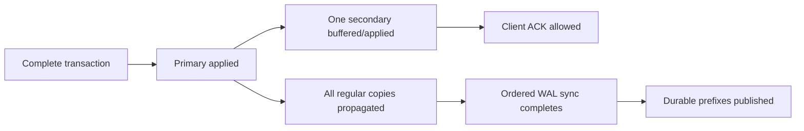

**Takeaway:** buffered success, all-copy propagation and disk durability are different milestones and different metrics.


### 6.1 Envelope and acknowledgement

Envelope fields: `protocol_version`, `partition_id`, `generation`, `config_version`, `owner_epoch`, `lease_id`, `seq`, `prev_digest`, `request_identity`, `request_digest`, `conditions_result`, `mutations`, `result`, `record_digest`. Sender authentication binds node identity; unauthenticated append is rejected.

The secondary checks epoch/config membership, previous digest, exact sequence and size before mutation. Same sequence/same digest is idempotent; same sequence/different digest quarantines the stream. Gaps return `NEED_PREFIX`, never speculative out-of-order apply.

Track per replica: `received_seq` (diagnostic), `buffered_applied_seq` (complete engine batch), and `durable_seq` (confirmed fsync prefix). All are partition/lineage qualified; only complete contiguous transaction boundaries advance.

The storage adapter exposes `sync_wal_through(captured_prefixes)` as two halves, begin and finish (ruling A-R317, M10). Begin runs after every captured WriteBatch call has returned. It fixes what the sync may credit: for each prefix, the lower of the captured position and what the engine has applied. The fsync then runs on the node's syncer thread, never on the node's own thread. It syncs each WAL file through a handle of its own, not RocksDB's, because Windows serializes all I/O on one synchronous file handle: syncing through RocksDB's handle made every commit wait for the whole fsync (critic-f4 P1, ruling A-R365). Finish raises the durable marks to what begin fixed and never lowers them.

Writes may commit while the fsync runs. A write that returned before the sync began is durable once that sync succeeds. A write that commits during the sync is not credited by it: it is durable only after the next sync that begins after it returned. This is safe because, with manual WAL flushing off, each record reaches the OS before its write returns, and a sync covers every WAL file numbered at or below the current one when it begins.

While a sync is in flight, the node's thread runs no synced write and no second sync, because RocksDB would make either one wait for that fsync. Such writes are staged, unsynced, and the next sync makes them durable. A sync in flight longer than `sync_stuck_millis` (default 5 s) is a stuck disk: the node faults, and its grant lapses for another node to take over.

Disable manual WAL flushing and optional concurrent or pipelined writes unless this ordering is requalified. The adapter must prove that the chosen native version fsyncs every captured complete transaction; a memtable flush is not a substitute.

Only unambiguous success publishes the captured prefixes. Error or partial completion advances nothing. This contract requires validation; source inspection has not established it.

### 6.2 Timing and pause policy

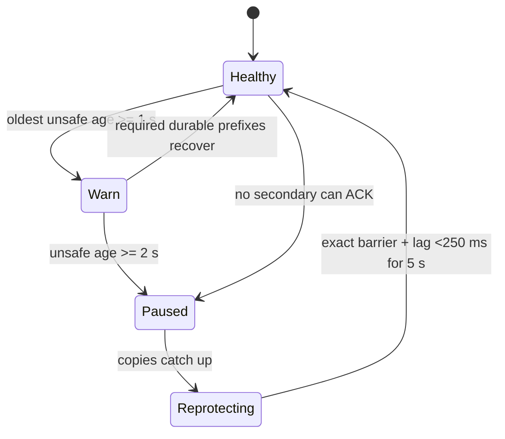

**Takeaway:** lack of an ACK secondary blocks success immediately; the two-second threshold governs broader protection lag, not local-only writes.


| Setting | Initial default | Contract |
|---|---|---|
| Group WAL sync | Background flush every 100 ms; a waited sync starts at once when no sync is running, and otherwise queues behind the running one and starts when that one finishes | No guaranteed maximum; record completed sync latency and durable age |
| All-regular-copy propagation | p99 ≤20 ms healthy local target | Measured from local apply to minimum regular `buffered_applied_seq`; not guaranteed RPO |
| Unsafe-age warning | 1,000 ms | Age of oldest applied transaction not durably present on required regular copies |
| Unsafe-age pause | 2,000 ms | Reject new admission within additional 100 ms under tested scheduler budget |
| Health evaluation | Every 50 ms plus progress events | Idle partitions with no outstanding transactions do not become falsely unsafe |
| Resume | All configured regular copies durable through paused prefix; lag below 250 ms for 5 s | No timer reset merely because a replica was renamed/replaced |

"All configured regular copies" means those lag protection does not hold lost: ADR-rdb-0006 §1
defines the lag domain as the copies minus self minus lost. The trace exports that set as
`ProtectionState.lost_copy_set`, and INV-LAG reads it (M9 S0, 2026-10-07).

Required copies are pinned by configuration version. Membership changes cannot erase old exposure: use a durable transition barrier and lineage checkpoint, then explicitly retire the old predicate. Export age and outstanding bytes separately.

If no regular secondary can ACK, success stops immediately. The 2 s threshold is not permission to ACK locally for 2 s. Pausing does not retroactively protect old ACKs; after a long outage their age-at-loss can greatly exceed 2 s.

### 6.3 Copy-loss contract

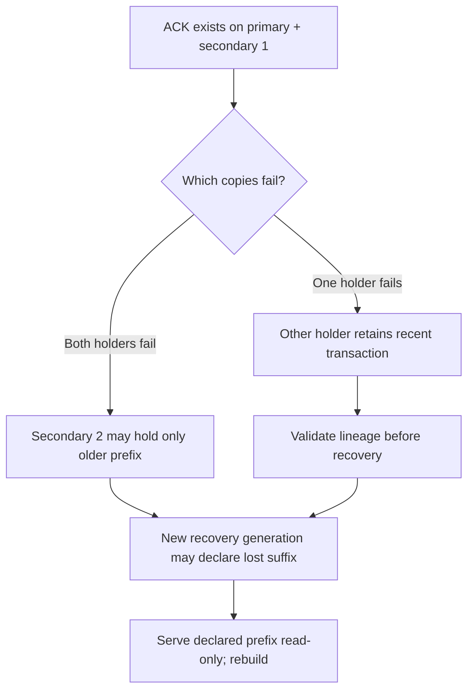

**Takeaway:** a buffered two-copy ACK protects common single-copy failures, not arbitrary loss of the exact two holders.


With three copies, primary+one buffered ACK does not ensure the third has the transaction. Losing both initial holders can lose the recent suffix; returning a whole earlier prefix is allowed only through explicit recovery generation change.

Common-power-loss and fsync/device correctness are separate failure models. Optional shadows may offer a validated recovery source but never acquire primary role; copy their history into regular membership through the same recovery checks.

## 7. Control metadata and authority

### 7.1 Authoritative records

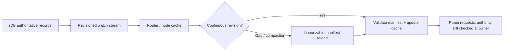

**Takeaway:** watches refresh routing caches; a gap forces coherent reload, and cached routing never grants write authority.


| Key family | Required content |
|---|---|
| `cluster/schema` | Cluster UUID, protocol/schema versions, minimum compatible data version |
| `nodes/{id}` | Boot UUID, role, failure domain, capacity, cores, drain state |
| `grants/{node}` | Grant ID, authority generation, allowed boot UUID, expiry, renewal version, mode |
| `partitions/{id}` | Range, group-hash version, owner, owner epoch, generation, membership/config version, lineage root, lifecycle state |
| `routes/{range}` | Versioned route root/manifest pointer; authoritative atomic cutover key |
| `operations/{id}` | Idempotent operation type, expected versions, phase, checkpoints and outcomes |
| `planner/grant` | Active planner authority and renewal version |

**Amended 2026-10-23 (M10 S2, lead ruling A-R225 R2-A2): a peer's boot is not read from `nodes/{id}`.** The owner takes each peer's boot UUID from the authenticated net handshake, which is bound to the node label in the peer's certificate. Inside one process it uses the local boots. It does not use `grants/{node}` either: most secondaries hold no grant, and a record can name a process that has died. The `nodes/{id}` row's boot UUID is still the right field, but it is not the source of a pinned member's boot. `Member::boot` in `crates/rdb-core/src/contracts/membership.rs` carries the same amendment.

High-frequency replica watermarks/heartbeats are data-plane telemetry, not rDB writes per transaction. Control records change on authority, membership or lifecycle transitions.

Use single-record revision CAS for authority transitions. Never assume a multi-key rDB transaction: staged records become active via one CAS manifest/root pointer. Readers validate referenced versions before activation; incomplete staged data is inert.

Watch events invalidate caches; they do not grant authority. On gaps/compaction, reload a coherent manifest and resume from its recorded revision. Validate parent/root version before accepting a partially fetched view.

### 7.2 New lease contract — release-blocking

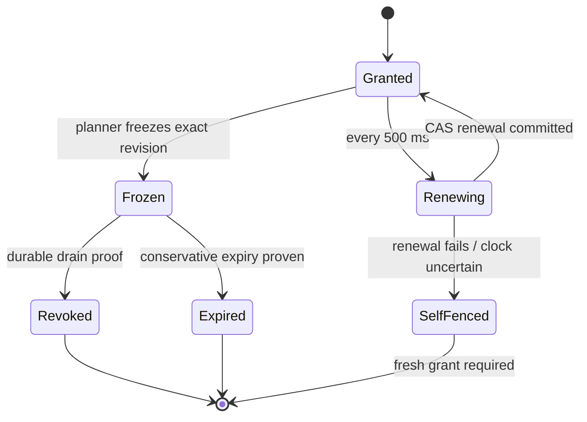

**Takeaway:** a node keeps rights only through successful revision-checked renewal; clock uncertainty, a freeze or expiry removes admission rights.

**Amended for issue #80: control-plane uncertainty does not remove admission.** A node that cannot reach rEtcd, or does not know whether a renewal committed, keeps serving writes and reads on the grant it has already proved, up to that grant's horizon: `renewed_at + grant_millis − dispatch_margin_millis − 1`, about 5.9 s after its last committed renewal at the defaults. There it fences `Expired`. Meanwhile it takes no new grant and no promote runs. No-overlap rests on the grant alone: the old owner stops at `E − ε − δ` whatever it can read, and a new owner waits for `E + ε + δ`. [ADR-rdb-0007](../ADRs/rdb/0007-fenced-grants-and-epochs.md) "A control-plane `Unavailable` and an unknown CAS outcome neither deny nor fence" holds the full rule and what it costs.

**Clock uncertainty is the clock guard's word (issue #80 S2c).** A node's clock bound holds only while the node and the peers whose fresh verdict (at most 5 s old) is Agree are a majority of the cluster, and outnumber the fresh Breaches. A node without one has no bound: it admits nothing (`ClockUnbounded`), and a promote run on its clock is refused before it writes anything.


The selected design requires new fenced-grant semantics; inspected rDB surfaces do not establish an existing implementation. A grant service uses rDB consensus to serialize grant/renew/revoke state; it is not a separate authority outside rDB.

Default grant duration is 6 s (3 s until issue #80), renewed every 500 ms. Grant expiry `E` is persisted in control metadata, qualified by cluster authority generation and node boot UUID. Renewal is CAS against the unfrozen grant revision; delayed renewals after freeze/revocation cannot resurrect it.

**Bounded-clock mode:** configure verified maximum UTC error `ε=100 ms` and dispatch margin `δ=100 ms`. Old owner admission requires its clock `C_old < E−ε−δ`; new activation requires authority clock `C_auth > E+ε+δ` after a linearizable read of the final frozen expiry.

Under the stated clock-error assumption, old admission precedes true time `E−δ`. New activation follows true time `E+δ`. A process can still pause between its last check and a physical mutation.

Revalidate at IO dispatch and isolate physical effects in an epoch/generation namespace. A late old-epoch write may remain as quarantined bytes, but it cannot be published, acknowledged, exported, replicated into the active lineage or dispatched as an effect.

Revalidate at publication and reply. New-epoch activation first drains/cancels old jobs or builds a separate namespace. Safety means one accepted lineage; it does not mean an expired process can never write bytes.

Clock uncertainty beyond the configured bound, backward jumps, process resume, reboot or authority-generation change invalidates cached grants. Such nodes stop accepting requests and acquire a fresh grant; automatic promotion is disabled when error bounds cannot be established. Verified external machine fencing is the fallback, not an assumption that an unreachable machine is dead.

**Same-boot fresh grant (M9, lead ruling A-R96).** A self-fenced node needs no restart to leave `SelfFenced`. Once a read of its own grant record proves that record's expiry, it replaces the record by a CAS at exactly the revision read, under a new grant id. It never returns to the grant id the fence ended. A planner's freeze makes the record unreplaceable.

A renewal sent before a fence can still commit after quorum returns (seen in M9 S2b walks 4a, 4b and 4c, with a write in flight or none: a renewal answered `unknown` landed as the next revision, still under the fenced grant id; when it lands after the self-replace read, that CAS conflicts and the owner resumes under grant 3 rather than 2). So a planner may read a later expiry than the owner believed it held. That is safe: every decision proves expiry on the record it actually read, and a self-replace CAS that conflicts re-reads and proves again.

**M10 gate:** the self-replace has no partition-in-transfer guard. That is safe in M9 only because M9 never starts a takeover, so the freeze is the only gate needed. Before M10 enables transfers, the self-replace must refuse while a transfer of any partition the node owns is in progress; otherwise an owner can contend with a planner mid-transfer.

**M12 gate (critic advisory A1):** at Publication, a deny for `ClockSampleStale` or `ClockModeUnbounded` quarantines the write, as every deny but `ControlUnavailable` does. Neither fences, so no new grant follows and nothing thaws the write: it stays quarantined for as long as the grant lives. M9's host cannot produce either, because it stamps every clock sample at "now". A real clock source (M12) must first make P1 defer these denies, or thaw them once a fresh sample or a bounded mode returns.

**Sizing note: grant length against control failover (added 2026-10-12, M9 S2b).** A control-leader failover must leave a renewal inside the write horizon, or one failover fences every owner. A1 admits until `grant_millis − dispatch_margin_millis − clock_error_millis − 1` after its last committed renewal (`Authority::admission_horizon`). That time is `renewed_at`: the tick the renewal CAS was dispatched, not the tick it committed (K-A-06); a record A1 adopts without seeing its commit derives it from the record's expiry instead. That renewal can be one `renew_millis` old when the leader stops. The new leader must then be in place with one more renewal to spare. So:

`control failover + renew_millis < grant_millis − dispatch_margin_millis − clock_error_millis − 1 − renew_millis`

- With the defaults (6000, 100, 100, 500) the right side is 5299 ms. It was 2299 ms at the 3000 ms grant before issue #80.
- rEtcd's default timers allow a failover of up to about 3000 ms (two `election_timeout_max`). With `renew_millis` that is 3500 ms, 1799 ms inside the horizon. At the 3000 ms grant it broke the rule. Measured in M9 S2a: the voters elected 2338 ms after the stop, 3 ms past the horizon, and the owner fenced `Expired`. Row `the_grant_covers_a_control_failover_under_default_timers` holds this.
- `rdb_dev`'s control timers give 1000 + 500 = 1500 ms, which leaves 3799 ms for the renewal's RPC and commit. Row `control_failover_leaves_a_renewal_inside_the_write_horizon` holds that.
- Owed to M10: a startup check against the voters' real timers (needs `--control ENDPOINTS`; `dyn ConfigStore` hides them). A failover longer than the horizon still fences every owner, and writes then stop until the same-boot fresh grant (above) proves the old grant expired and replaces it, which takes at least the rest of that grant plus `clock_error_millis + dispatch_margin_millis` once the new leader answers.

**M9 note: a node restart stops writes, safely, for the life of the `Db` (added 2026-10-12, M9 S2b; achieveai/rDB#42).** `Db::restart_node` starts the node again at boot + 1. Peers' membership pins the old boot (`Member::boot`), so they refuse the new process's acknowledgements, and the new process holds no role, no grant and no pending acquire.
- Restarting a **secondary**: its copy is never durable again, so L1 pauses writes within about 2 s of the next write (§6.2). With no fence that is about 2 s after the restart. After a fence nothing is unsafe until the next write, so it is about 2 s after that write (tester q8).
- Restarting the **owner**: it never takes a grant again. Its old grant can be cleared once expiry is proven (§7.3), but nothing acquires a new one. The same-boot fresh grant does not apply: it belongs to the process whose grant was fenced, and a restarted process holds no grant to replace.
- In M9 nothing un-pauses writes after either restart. **M10 (A-R256(2), A-R275): a restarted secondary rejoins by itself.** The owner hears its new boot, drains its epoch and re-plans with that boot, and writes resume once the copy syncs. A restarted owner still stays out until the folder is opened again.
- Reads after a **secondary** restart keep answering, with one exception. If a write was in flight at the restart and no other copy can take it yet, fresh reads answer `UNKNOWN_OUTCOME` and the unresolved-transaction freeze holds (§5.3, K-A-47); `--previous` reads still answer. The freeze lasts only while no copy that did not restart can take the write. If the other secondary takes it, it publishes and reads keep answering. If the other secondary was only unreachable, healing that link resolves the write in M9. Only when both secondaries restarted does it wait for M10 (#42). (M9 S2b walks 5b, 5d, 5e; tester walk 5, n4.)
- Reads after an **owner** restart answer `UNAVAILABLE`, `--previous` included: in M9 the owner is the only node that serves reads.
- Every `PROTECTION_PAUSED`, `UNAVAILABLE`, `UNKNOWN_OUTCOME` or `NOT_PRIMARY` answer names the restarted node and boot. It then says what is true now: "a restarted copy rejoins by itself once the owner re-plans", or "the owner stays out until the folder is opened again"; a failed restart adds nothing more. The note is one short clause, since it rides on every refused answer. A status of `Unknown` after a restart is not evidence that a write was lost, even one answered `ok`. After the owner's restart, or both secondaries', its outcome cannot be known until a restarted node rejoins (#42). After one secondary's, it resolves once the other secondary can take the write, but only for a write node 1 holds in flight (applied, not yet published). A write refused at admission was never queued, and nothing resolves it (tester W6-D1). `rdb_dev` adds the matching note to it, and none for a request the session never sent. A resend or retry refused `PROTECTION_PAUSED` says `status <id>` shows its outcome only when it will: node 1 holds that request in flight, or status already answers more than `Unknown`. A retry of a write that already finished is refused paused too (F1). A new write's refusal does not say it.
- After a **secondary** restart, L1 keeps admitting writes until it pauses, as above (walk 6c, tester q8). `rdb_dev` then prints `ready for now; writes pause soon, at the latest about 2 s after the next write, because ..` rather than a bare `ready`.
- A restart is therefore never a recovery step in M9. Writing again takes a new `Db` on a new directory and control store: the same ones cannot be reopened (`OpenError::NotEmpty`, `BootstrapError::AlreadyExists`).

### 7.3 Ownership transition protocol

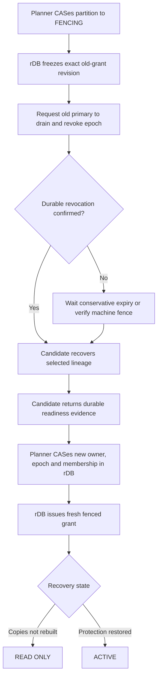

**Takeaway:** reachability does not elect a primary; rDB activates one only after the previous authority is safely revoked or expired.


1. CAS partition state to `FENCING`; freeze old-node grant renewal using its exact revision. Serialize renew/freeze races in rDB.
2. Ask the old owner to drain, stop queues and persist an irrevocable partition-epoch revocation. An ACK counts only if restart cannot restore that epoch.
3. If no verified drain/revocation, await final grant expiry under the clock contract or verified external fencing. Expiring a node grant may temporarily fence its other partitions too.
4. Issue a renewed grant excluding the revoked partition epoch to a cooperative old owner; install new membership/generation and owner epoch in one authoritative partition record.
5. Recover and durably establish the selected lineage before `READ_ONLY` or `ACTIVE`; receivers reject stale epochs, including already queued network packets.
6. Check authority at entry, storage dispatch, publication, reply and outbox dispatch. Baseline destination dedup prevents duplicate IDs only; authority-safe workflows additionally require destination epoch/version fencing or explicit reconciliation. No unqualified exactly-once guarantee.

**Owed to the planner, not built yet (amended 2026-10-12, lead ruling A-R94).** No planner code freezes or creates grants today; the simulator's grant-clearing service (`rdb-sim` `clear_restarted_grant`) is the only control-plane writer of `grants/*`.

- **Step 1 when the old owner has no grant.** Freeze the prior owner's grant at its exact revision, or, when `grants/{node}` is absent, **create-only a frozen `GrantRecord`** for that node. An absent record cannot tell a cleared grant from one never issued or one about to be issued, and the owner serves its partitions whatever their lifecycle once it holds a grant, so absence proves nothing about the old owner. A frozen create gives the candidate a frozen record to prove expiry against: the takeover kernel parks a lineage whose grant read answered absent and builds the takeover from the next strictly newer record. It also blocks the node's create-only acquisition and is never deleted by the clearing service (`clear_verdict` guard 1, "not frozen"). It is cleaned up like any frozen grant, under step 4. For its values, any `expiry_utc_ms` at or before the planner's own proven control time is safe: safety does not rest on it, because the create-only write succeeding already shows no grant stands, and the candidate proves expiry once its control time passes `expiry_utc_ms + epsilon + delta` (`expiry_proven`, the inequality of `clear_verdict` guard 2), so a later value only adds a pointless wait. `boot` is the last boot the planner knew for that node, since that is the boot an external fence claim must name to be accepted (T11, `ExternalFenceMismatch::PriorBootId`).
- **The clearing service must not race a fence.** `clear_restarted_grant` reads `partitions/*` (for `clear_verdict` guard 3) to check that every partition the node owns is `Serving`, then deletes the grant with a compare on the grant key alone. A `FENCING` write landing between that read and the delete breaks "a grant cannot vanish mid-transfer". A real service must make the delete conditional on the partitions revision it read, or be the single planner writer. The simulator is single-threaded, so it holds there.
- **M9 host: single writer, with an M10 tripwire (added 2026-10-12, M9 S2b).** The host now has a second clearing service, `rdb-api` `admin::clear_grant`. rEtcd's `ConfigStore` has no multi-key compare (only a per-key `expected_mod_revision`), so it cannot make the delete conditional on the partitions revision. It takes the single-writer branch instead: in M9 the only `partitions/*` writers are `admin::bootstrap` and F1's commit, and both write `Serving`, so neither can make guard 3 false between the read and the delete. (`rdb_dev`'s `control lifecycle` verb writes other lifecycles, but it runs in the same single-threaded REPL as the clear.) **Tripwire:** the first writer of a non-`Serving` lifecycle, which is the M10 planner, must also be the clearer, or rEtcd must gain a compare-transaction first.
- **M10 entry gate: the frozen create.** The step-1 frozen create above is not needed in M9: no takeover runs, because the owner is always node 1 and nothing writes a non-`Serving` lifecycle. But "owner restarted, grant cleared, new boot never acquires" is the normal M9 state after an owner restart, and that state plus one planner move is the takeover kernel's park case. So the frozen create must exist before M10 lets a planner move a partition.

Control-quorum loss prohibits new grants and promotions. Existing grant-backed service lasts only until conservative local expiry. Disaster recovery of the control cluster must change authority generation and fence old grants; it is a separately gated operation.

## 8. Recovery and divergent history

### 8.1 Lineage rules

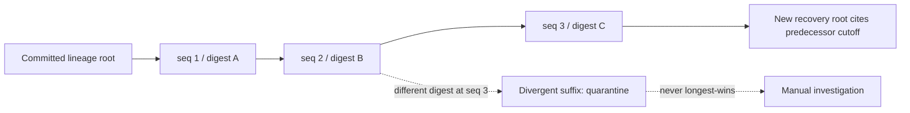

**Takeaway:** authority follows the committed root and digest ancestry, never whichever replica happens to have the longest sequence.


A lineage root in rDB contains `(partition, generation, owner_epoch, base_seq, base_digest, predecessor_generation, predecessor_cutoff)`. Every child history must descend from that root; sequence length alone never selects authority.

Within the same prior authoritative epoch, no new owner has yet written, so compatible contiguous histories can be compared by hash ancestry. A generation that committed `ReadOnly` and took no writes does not begin a new authoritative epoch for this comparison (amended 2026-11-11, issue #105, §8.5). Select the longest validated prefix available from eligible survivors; buffered complete entries from a live survivor may be retained, but must be fsynced before the recovery barrier is committed.

After fencing, query every reachable eligible previous regular member and verified shadow within a 2 s discovery window. Extend the window while an advertised higher compatible prefix is transferring. If that source fails, record it as unavailable before choosing a shorter prefix.

Records cannot show whether the client received its reply. Select using validated ancestry, not inferred client ACK status.

An isolated holder may remain unavailable, so D6 permits loss-accepting recovery from the surviving prefix. Record queried sources, selected cutoff and loss uncertainty.

**Amended 2026-11-11 (issue #105).** Discovery also stops a writable commit in two cases. A queried or marked copy holds a current tail above the selected cutoff. Or the last writable generation is known and no verified copy holds it intact. The commit is then `ReadOnly`. §8.5 has the rules.

A status query may report `RECOVERED_APPLIED` for a retained request digest/result, never claim the client received the original reply. Old-generation identities remain queryable for the 24 h dedup window through the retained lineage mapping; absence after recovery or expiry returns `UNKNOWN_OUTCOME`/`STATUS_EXPIRED`, not proof of nonexecution. Mutating retries still require explicit generation reconciliation.

Different digests at the same lineage position are corruption or a fencing violation, not a normal tie. Quarantine and block automatic promotion. A returning old owner never overrides a newer committed **writable** root, even with a longer suffix (amended 2026-11-11, issue #105: a newer `ReadOnly` root does not override it, §8.5).

### 8.2 Why different secondary tails still form one history

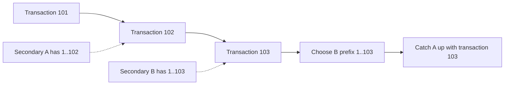

**Takeaway:** B cannot accept transaction 103 without 102; replicas differ only by suffix length, so recovery copies the missing suffix rather than merging unrelated changes.

The primary assigns one sequence at a time for a partition. A secondary accepts sequence `n` only when it has sequence `n−1` with the exact expected digest.

Suppose transaction 102 was acknowledged by A. Transaction 103 was later acknowledged by B. Before B can acknowledge 103, it must already contain 102; therefore B contains both transactions.

A and B may end at different sequences, but their shared sequence numbers must have identical digests. Recovery selects the longest compatible prefix and transfers its missing suffix to the shorter survivor. It never combines independent key changes or resolves them by timestamps.

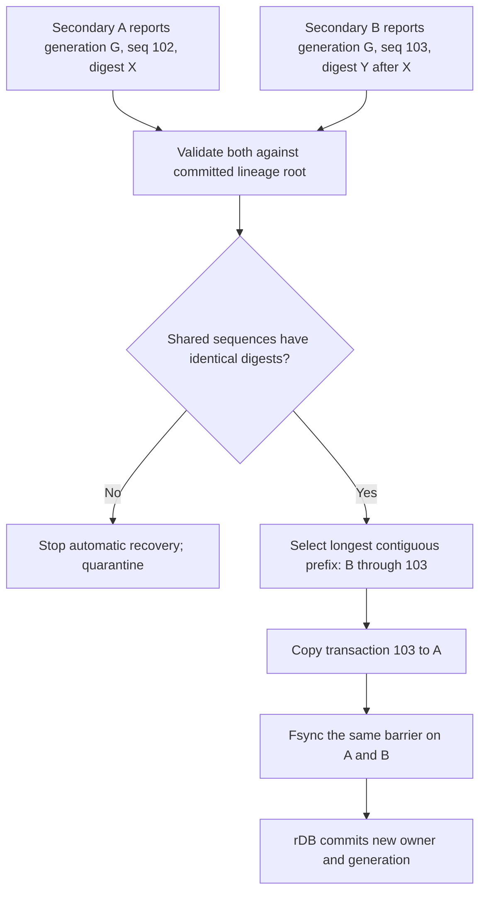

**Takeaway:** sequence plus hash ancestry decides the history; rDB records who may lead only after both survivors hold the selected barrier.

### 8.3 Single-node failure: resume with two synchronized copies

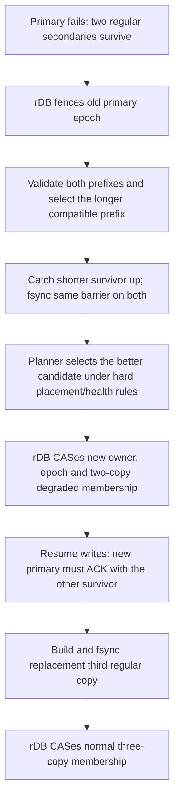

**Takeaway:** one failed node need not cause a long write outage, but writes resume only after the two survivors agree and every new write reaches both.

The longest-prefix survivor is normally preferred as new primary because it avoids reverse catch-up. It does not win merely by being longest: it must also be primary-eligible, healthy, within capacity, and hold a valid new grant. If it cannot lead, first copy its selected prefix to the eligible survivor, then grant that survivor ownership.

While running with two copies, both are required for every successful transaction. There is no one-copy fallback or two-second local-only allowance. Loss or unavailability of either copy immediately stops admission and enters majority-loss recovery.

The planner creates a third regular copy urgently under normal failure-domain and resource constraints. Promotion and new writes do not wait for that bulk rebuild, but the partition reports `DEGRADED_RF2` until the replacement is caught up, fsynced and committed into membership.

### 8.4 Majority-loss read-only recovery

```mermaid
flowchart TD
  F["Fence old owner"] --> Q["Query every reachable eligible history"]
  Q --> V{"Same lineage and digest ancestry?"}
  V -->|"Conflict"| X["Quarantine; manual recovery"]
  V -->|"Compatible"| S["Select longest validated whole-txn prefix"]
  S --> R["Commit new recovery generation in rDB"]
  R --> RO["Serve reads only from declared prefix"]
  RO --> B["Rebuild and fsync three regular copies"]
  B --> A["CAS ACTIVE; resume writes"]
```

**Takeaway:** with only one surviving regular copy, reads resume from its declared prefix; writes wait for two validated durable copies under §8.3's rule, and for three to return to `ACTIVE` (amended 2026-11-11, owner decision on issue #105).


1. Fence old authority and determine the current authoritative lineage from rDB.
2. Freeze survivor apply; validate history checksums and complete transaction boundaries; capture the readable prefix.
3. Flush the survivor prefix durably. Persist a CAS recovery root with a new generation/epoch and declared cutoff.
4. Open reads on that exact prefix with `recovery_mode=true`; reject mutations and actor activation.
5. Rebuild regular copies from this root. Require all three to fsync the same prefix and validate checksums.
6. CAS to `ACTIVE`; resume writes after health hysteresis and fresh grants. Explicit client generation refresh is required.

**Amended 2026-11-11 (issue #105, owner decision of 2026-11-09): writes may resume on two copies.** Steps 5 and 6 describe the way back to `ACTIVE`. Writes return earlier. Once a second copy is back, a re-plan commits `DEGRADED_RF2` under §8.3's rule: two verified copies, both fsynced through a barrier-proved cutoff, both required for every write. The code did this before the spec said so (`mode_for`). The hazard issue #105 found was a live copy's tail left out, not two copies. §8.5's guard and intact rule close that.

Returning replicas with stale suffixes are quarantined read-only for diagnostics, then rebuilt from the authoritative snapshot. A suffix stamped by the last writable generation is not stale: it is a survivor's history, and §8.5 adopts it (amended 2026-11-11, issue #105). Do not delete a suffix and assume already-applied user values roll back: replace the affected partition prefix in a staging namespace and switch its local manifest atomically.

Quarantined suffix retention defaults to seven days and capacity permits; deletion requires operational policy approval. It is not merged automatically into current data. A suffix adopted under §8.5 was never quarantined. Proven corruption may require manual restore and is outside automatic majority-loss recovery.

### 8.5 A live copy's tail: the guard and the way back

Added 2026-11-11 (issue #105, units 1 and 2). It states what the code does. The owner's decisions of 2026-11-09 are marked where they apply.

**The loss it fixes.** A write confirmed on two copies (`BufferedOnTwo`) could be lost while a live copy still held it. A `ReadOnly` recovery left that copy out. A later recovery committed writable at a lower cutoff, and the next write reused the seq. `wait_durable` `Ok` records were not lost on any schedule walked.

**Terms.**

- **L** is the last generation that committed writable.
- A **tail** is records a copy holds above a plan's base, on a lineage other than the anchor's.
- A tail is **current** when the record at its head is stamped L. Stamped below L, it is **superseded**, and recovery treats it as before.

#### 8.5.1 The ledger

`partitions/{p}` carries a `TailLedger` (record layout 6):

- `last_writable`: L, or `None` for unknown.
- `last_writable_regulars`: the nodes pinned as regulars in L.
- `held`: one `HeldTail { node, head }` per node holding a tail above a cutoff.

Every recovery CAS and every activation CAS writes it. A promote's `Fencing` write keeps it. A writable commit sets L to its own generation. A `ReadOnly` commit carries L on. A record older than layout 6 reads as L unknown, never as "nothing held". A plan built from the store gets the ledger in `PriorRecord.ledger`. A plan built from memory gets it in `RecoveryResult.ledger`.

#### 8.5.2 The holder speaks

Before any refusal, a queried copy runs `Host::tail_scan` inside `Host::inventory`:

- With L known, it reads every lineage below the anchor's generation that is not staging and has a head above the base. A hit is a head stamped L. A head stamped above L is logged at error and held. A head stamped below L is ignored.
- With L unknown, it reads only the newest lineage below the anchor, and treats its tail as current.
- It is not a hit when the anchor's lineage holds the same digest at that head.
- A head that cannot be read is a hit with no stamp.
- The highest head wins. On an equal head with an equal digest, the newer lineage wins. On an equal head with different digests, the older one wins.

Any role counts, a shadow's included. A hit is adopted (§8.5.4), released by `forget-tail` (§8.5.9), or answered as `RecoveryEvent::TailHeld { copy, head, stamp, reason }`. Once a copy found a tail, a later refusal in the same answer is still `TailHeld`, never a bare `InventoryFailed`.

The same scan runs when a copy lands a commit for the first time (`Host::landing_scan`), with L from the result. A hit there marks the copy's status `tail_refused`.

#### 8.5.3 F1 caps the mode

`mode_after` makes a commit `ReadOnly` where `mode_for` would make it writable, when either holds:

- **A held tail.** A copy holds a head above the selected cutoff. That covers this run's `TailHeld` answers, a late `InventoryReported` above the cutoff, and the ledger's entries for nodes that did not verify in this run.
- **The intact rule fails** (§8.5.5).

A tail heard in any phase before the CAS is built counts. The mode and the ledger are fixed when the CAS is built. A tail heard after that is too late for this run, and the copy answers the same way at the next one.

A capped commit arms no rebuild. A copy holding a tail above the cutoff also withholds its post-commit sync proof (`sync_withheld`, `reason=tail_held`). So a rebuild cannot activate past it.

A plan that leaves out a node the ledger marks is blocked with `BlockReason::DropsMarkedHolder { node }`. Nothing is fenced and nothing commits. A node left out would never be asked again, so its mark could never clear.

**When a mark clears.** A node's entry clears when it verifies in a run, when `forget-tail --through` covers it, or when a later cutoff reaches its head. A bare failure never clears it. If the holder dies, the partition stays `ReadOnly` until it returns or an operator runs `forget-tail`.

#### 8.5.4 Adoption: the way back is automatic

**Owner decision (2026-11-09): automatic.** No operator command is needed when a live copy can bring its tail back.

A holder adopts the tail inside its inventory answer. It then reports as an ordinary longer survivor. F1's selection, catch-up and barrier are unchanged. Writes cannot land first: a commit needs the holder's answer, and that answer has either adopted or capped the commit.

`Host::adoption` reads only. It checks, in order:

1. **P3.** L is known, and the tail's head is stamped L.
2. **Not set aside.** No earlier `forget-tail` sealed the tail's lineage under a copied child.
3. **P1.** The digest at the anchor's base, on the tail's chain, equals the anchor's.
4. **P2.** Every record from the base to the head reads, verifies and chains.
5. **The write's preconditions** for the chosen way, below. These mirror what the storage engine's `inherit` would refuse, so `Adoptable` means the write will succeed.

`Host::adopt` then writes it one of three ways:

- **Link.** The copy holds no lineage at the anchor's generation. `inherit` links it onto the tail's lineage at the tail's head. At the chain depth ceiling (32 levels) the link is a full copy instead. That copy runs on the host thread, at most once per 32 levels.
- **Resume.** An earlier adoption's full copy crashed part way. The copy finishes it with the same arguments, then links.
- **Replay.** The copy already holds the anchor's lineage, linked, with its head at or above the base. It appends the tail's records with `record_batch`, as a receiver would. The first record must chain from that head. At most `ADOPT_REPLAY_MAX` (1,024) records are replayed. A longer gap is refused `tail_too_long` before the tail's chain is walked, so the holder never reads a tail it would refuse.

After any of them, a receiver held on that copy is dropped. A catch-up it then sources rebuilds a full ladder from the engine. The copy logs `tail_adopted` with `from`, `to`, `head`, `stamp` and `how` (`link`, `flatten` for a link that became a full copy, `resume` or `replay`).

**What an adopted tail can hold.** A record cannot show whether its client got a reply (§8.1). So an adopted tail may hold a write whose client saw an error or no answer. That write becomes visible. A resend with the same identity is deduplicated: the dedup row travels with the record.

#### 8.5.5 The intact rule

**Owner decision (2026-11-09): kept.**

> A commit is writable only if a verified copy, of any role, on a node in L's regulars, holds lineage L intact.

Intact means not staging, and holding a record at seq 1 when L applied any. A copy reports it as `SurvivorInventory.holds_last_writable`. A wiped or rebuilt copy fails it. A flattened copy passes.

The rule is waived while L is unknown, over a first generation, and for a run given `--no-intact-copy`. While it applies and no L-regular has verified intact, the discovery window waits once more for a silent one (`recovery_window_extended_for_intact`).

It is a backstop. On the schedules walked, no `wait_durable` `Ok` record was lost without it.

#### 8.5.6 Adoption states and refusal reasons

A copy holding a tail shows it in `Db::node_status` as `tail_refused`, with `adoption: TailAdoption`:

| State | Meaning | Repair | `forget-tail --through` over it |
|---|---|---|---|
| `Adoptable` | Every proof holds, and the write will succeed | Re-plans; the next inventory adopts it | Needs `--give-up-live-copy` |
| `NotReady(reason)` | The proofs hold so far, but a precondition is not met yet | Holds | Needs `--give-up-live-copy` |
| `Refused(reason)` | A proof failed. The tail cannot come back | Holds | Needs no flag |
| `Unchecked` | The copy refused without running the proofs, or a write failed after they held | Holds | Needs `--give-up-live-copy` |

`ADOPTION_REFUSALS` holds every reason, 11 in all. The first three are `NotReady`:

| Reason | State | Meaning |
|---|---|---|
| `replay_not_ready` | `NotReady` | The anchor's lineage is not linked yet, is staging, or is below the base. A later landing ends it |
| `tail_parent_copying` | `NotReady` | A `forget-tail` set-aside of this lineage crashed part way. That release's re-run ends it |
| `tail_sealed_for_other` | `NotReady` | The tail's lineage is sealed by another child. A backstop: the scan does not reach it |
| `last_writable_unknown` | `Refused` | L is unknown, for example after an upgrade |
| `tail_not_last_writable` | `Refused` | The head is not stamped L |
| `tail_head_unreadable` | `Refused` | The head record cannot be read |
| `tail_set_aside` | `Refused` | An operator already gave this tail up |
| `base_digest_differs` | `Refused` | P1 failed: corruption or a fencing violation (§8.1) |
| `tail_not_contiguous` | `Refused` | P2 failed: a hole or an unreadable record |
| `anchor_lineage_differs` | `Refused` | Replay: the anchor's lineage does not chain into the tail |
| `tail_too_long` | `Refused` | Replay: more than `ADOPT_REPLAY_MAX` records |

`TailAdoption::could_return` is true for every state but `Refused`.

The owner's membership repair re-plans only when every held tail is `Adoptable`. A stalled rebuild copy whose tail is `Adoptable` does not hold that repair back, since the re-plan is what adopts it.

A copy whose newest lineage is a staged copy that crashed part way reports `interrupted_copy`. It is `Adoptable` when the staged copy is of a whole tail, which the next adoption resumes, and `Unchecked` otherwise.

A refused write while a tail holds the partition answers `RECOVERY_READ_ONLY`, naming the copy and its seqs:

- every named tail `Adoptable`: "the copy named here can restore these seqs, and writes will return on their own";
- otherwise: "writes stay refused until the copy named here returns with these seqs or an operator runs `admin forget-tail`, which accepts losing these seqs".

Both say not to wipe or rebuild the named node.

#### 8.5.7 Late and stale asks

The link to a copy queues asks while that copy is down. After a restart it can answer asks the owner has already moved past.

- **An ask behind the copy is late.** If the copy holds a lineage newer than the ask's anchor, it skips the scan and adoption. `survivor` answers `copy_ahead_of_anchor`, logged `inventory_late` at info. This is safe: a lineage at generation N is written only for an ask, a landing or a result at N, so that ask's commit cannot succeed.
- **An adoption whose answer missed its commit leaves a link.** The next ask under the same L finds the tail on two lineages, at the same head with the same digest. The newer lineage wins, so the copy links again from it.
- **The asker drops an answer whose anchor is not its plan's.** A stale adoption cannot make a plan take a wrong record, and it loses no write.

#### 8.5.8 The owner behind the cutoff

After adoption, a live `ReadOnly` owner may be the one copy behind the new cutoff. A recovery catch-up must reach its store.

- **Stand-down.** A primary whose last `Recovered` committed `ReadOnly` stands down when A1 revokes its own epoch (`Primary::on_view`, logged `primary_stood_down`). All of these must hold: the view is accepted, it is for the primary's generation, `past_horizon` is `EpochRevoked`, its owner epoch is at or above the primary's, and the recorded mode is `ReadOnly`. A lag-paused `Active` primary is not stood down.
- **What it does.** The tracker is retired and marked (`ProgressTracker::stood_down`). Cursors, shipped records and started shadows are cleared. The keepalive and the shadow probe stop. Status still shows the node as `primary`, not admitting.
- **What `Recovered` then does.** For the generation it stood down in, it answers `NotRequired` and the primary stays down. For a newer generation that pins it primary, it is rebuilt at the cutoff, or replaced by a fresh primary when its ladder lacks the cutoff. Pinned anything else, it stays retired.
- **The catch-up target.** The routed catch-up carries the cutoff's digest (`through_digest`). Under a credential the kept catch-up plan names, an older-generation record at or below the plan's cutoff is historical. At the cutoff its digest must match, or the stream quarantines `DivergentHistory`. A plain append is unchanged.

#### 8.5.9 `admin forget-tail`

It is the only way out when no live copy can bring the tail back. It runs on the owner (`Db::forget_tail`; `rdb_dev admin forget-tail`). Only an admin app may send it.

```text
admin forget-tail --partition P --through H [--give-up-live-copy]
admin forget-tail --partition P --no-intact-copy
```

- **`--through H`** gives up every held tail at or below H, for one run. Those entries clear, the commit may be writable, and L moves. It does not waive the intact rule. A tail above H still caps.
- **`--no-intact-copy`** waives the intact rule for one run. Held tails still cap.
- Both may be given together.

It is refused, giving up nothing, when:

- H is at or below the committed cutoff;
- no copy holds a tail above the cutoff;
- a live copy reports a tail that could come back (`Adoptable`, `NotReady` or `Unchecked`), unless `--give-up-live-copy` is given. A holder the committed ledger marks that no repair probe has reported on yet counts as `Unchecked`; a probe's report, `Refused` included, stands over the mark. For `Adoptable` and `NotReady` the refusal says the node "can bring them back; no operator action is needed". For `Unchecked` it says that has not been checked;
- `--no-intact-copy` is given and the intact rule did not cap the owner's last commit;
- another re-plan is running.

The owner re-plans with `RecoveryPlan.release`. F1 copies `through` onto that run's inventory asks as `release_through`. A released holder logs `tail_released` and reports at the base. It sets the tail aside with `inherit`'s copied mode: the old lineage keeps the tail, sealed, stamped below the new L. It is never merged.

What is given up is gone for good. Being accepted does not mean writable: the re-plan can still commit `ReadOnly`, for example with too few copies. The next run then holds the tail again.

#### 8.5.10 Upgrade, release and limits

**Owner decision (2026-11-09): the upgrade is one-way.** This build writes record layout 6, stored promote plan version 4 and `PROTOCOL_VERSION` 9. An older build reads a layout 6 record as undecodable, and the handshake refuses a version mismatch. So the whole cluster stops and restarts together, and there is no rollback. Until a partition's first writable commit on this build, L is unknown there: the intact rule is waived, and a tail found is refused `last_writable_unknown`. Such a tail needs `forget-tail` once. It needs no `--give-up-live-copy`, because it cannot come back.

**Owner decision (2026-11-09): units 1 and 2 release together.** Unit 1 alone can only give a live copy's tail up.

**Owner decision (2026-11-09): no probe of a dropped old owner.** A promote does not ask the old owner it drops. One loss remains: a `BufferedOnTwo` record whose other copy lost it or is silent, on an old owner a promote drops without asking, when a writable commit happens before that owner is added back. `wait_durable` `Ok` records are not affected. The same loss happened before issue #105.

**Known limits:**

- A silent holder whose tail no earlier run recorded is superseded when it returns, if an intact L-regular verified meanwhile.
- A copy left read-only by a dead holder stays read-only until the holder returns or `forget-tail` runs.
- Adoption does not restart the dedup retirement clock. A tail adopted about a day after a `ReadOnly` landing can lose its dedup rows soon after, so a resend could apply twice.
- Catch-up sends one record per round trip. A 500-record tail took about 4.5 s.
- The simulator does not model the tail scan or adoption yet.
- A barrier landing's crashed full copy looks like a resumable adoption, so it also reports `Adoptable`. If its proofs then fail, the repair re-plans in a loop that only its back-off slows.
- A rebuild source's snapshot merge across a link above the root base is not traced.


## 9. Placement, balancing and shadows

### 9.1 Hard constraints before balancing

```mermaid
flowchart TB
  P["Partition P"] --> R1["Primary-eligible regular copy / machine A"]
  P --> R2["Regular copy / machine B"]
  P --> R3["Regular copy / machine C"]
  P -.-> H1["Optional shadow / machine D"]
  R1 --> D["Distinct machine + failure-domain checks"]
  R2 --> D
  R3 --> D
  H1 --> X["Never primary; outside ACK readiness"]
```

**Takeaway:** each partition has three independently placed primary-eligible regular copies; shadows are extra and cannot win ownership.


- Three regular copies on distinct machines; a regular primary must be on a primary-eligible node.
- Shadows never primary; enforce separately from planner preference.
- Failure-domain spread when enough configured domains exist; reject unattainable strict constraints rather than silently downgrade.
- Do not place replicas on draining/unhealthy/full nodes or two copies on one machine.
- Respect core, memory, disk and network budgets, including incoming secondary work.
- Never move the last usable authoritative copy or delete source before target validation.

### 9.2 Deterministic planning

```mermaid
flowchart TD
  I["Node capacity, roles, domains, health"] --> H["Apply hard placement constraints"]
  H --> C["Rank candidates by weighted rendezvous"]
  C --> R["Repair copy-count imbalance"]
  R --> P["Repair primary-count imbalance"]
  P --> L["Adjust bytes + measured load"]
  L --> M{"Improvement clears movement threshold?"}
  M -->|"Yes"| O["Create one versioned move operation"]
  M -->|"No"| K["Keep placement; record residual skew"]
```

**Takeaway:** constraints win first; replica counts, primary counts, bytes and load are balanced in that order by one fenced planner.


Use weighted rendezvous ranking for candidate stability, followed by constrained repair. Weights represent provisioned capacity, not momentary free space. A single granted planner proposes incremental moves; every transition uses version-checked CAS and is idempotent.

Minimize lexicographically: constraint violations (must be zero), normalized regular-copy count skew, normalized primary-count skew, byte/load imbalance, then movement cost. Shadow placement has its own count/capacity objective across shadow-eligible nodes.

For homogeneous feasible placements, target count skew `max−min≤1` for copies and primaries separately. This is a target, not an unconditional guarantee with exclusions; the planner must emit a reason and best feasible residual skew when it cannot meet it.

Bytes/CPU override count perfection when a node exceeds 120% of mean normalized bytes or 80% sustained measured CPU for 60 s. Require a ≥10% improvement in the violated metric, observe a 60 s cooldown and honor movement budgets. Record why a count-balanced placement was intentionally relaxed.

No dedicated shadow pool is mandatory. In v1, a shadow-eligible node is configured as never-primary; role changes require drain and explicit configuration approval. Shadow lag does not pause regular writes by default; expose a distinct protection alert.

## 10. Catch-up, movement and partition growth

### 10.1 Snapshot/catch-up

```mermaid
sequenceDiagram
  participant S as Authoritative source
  participant DB as Logical history retention
  participant T as Invisible target staging
  S->>S: Capture partition barrier + snapshot
  S->>T: Manifest + hashed chunks
  S->>DB: Retain history after barrier
  T->>T: Verify chunks and import staging prefix
  DB->>T: Replay contiguous transactions
  T->>T: Fsync exact seq + digest
  T-->>S: Ready(barrier, seq, digest)
```

**Takeaway:** snapshot bytes are insufficient alone; the target stays invisible until verified catch-up reaches an exact durable lineage barrier.


Take a partition-consistent snapshot at `(generation, seq, digest)`. Export only that partition prefix with a manifest of chunk hashes, sizes, format version and root digest; no assumption that a whole core-engine checkpoint is a per-partition transfer.

Retain logical history from snapshot sequence until target catches up. Set a 30-minute/20-GB retained-history budget per partition, whichever comes first; exceeding it restarts snapshot rather than dropping required records silently. A slow target never causes unbounded history retention.

Target imports into an invisible staging prefix; verifies hashes; replays contiguous history and fsyncs. The ready ACK names the exact authoritative barrier. Atomic local manifest switching exposes only the validated prefix.

### 10.2 Planned copy/primary movement

```mermaid
sequenceDiagram
  participant PL as Planner
  participant S as Source copies
  participant T as Staged target
  participant R as rDB authority
  PL->>T: Create non-voting staged copy
  S->>T: Snapshot chunks + full catch-up history
  T-->>PL: Hashes + durable barrier
  PL->>S: Brief partition admission fence
  PL->>R: CAS new membership at barrier
  R-->>T: Membership becomes authoritative
  PL->>S: Retain old copy for rollback window
```

**Takeaway:** a target is invisible until fully validated; one rDB CAS changes membership authority.


Add a learner-like data copy outside regular readiness accounting; keep existing three regular copies active during transfer. At a brief admission fence, drain the partition, select a common durable barrier and activate new membership via one partition-record CAS.

Old membership predicates remain active until the barrier is confirmed by the new set. Primary movement additionally follows §7 fencing. Source deletion follows target validation, rollback retention and human-approved garbage-collection policy.

### 10.3 Splitting without breaking affinity

```mermaid
flowchart TD
  P["Parent approaches 40–50 GB"] --> B["Choose affinity-hash boundary"]
  B --> C["Stage two child ranges and copy state"]
  C --> H["Replay full parent history into child transforms"]
  H --> F["Fence parent at durable barrier"]
  F --> G["Create child genesis histories; fsync all copies"]
  G --> R["CAS route root: children active, parent retired"]
  R --> W["Children accept writes at sequence 1"]
```

**Takeaway:** the parent remains sole writer until both children are complete and one route-root CAS activates them.


Trigger split planning around 40 GB and seek completion before 50 GB. Select a boundary in the ordered 128-bit hash of `(tenant, affinity_id)` that approximates equal bytes; a stable hash version is in route metadata. Colliding groups may share a hash slot and remain colocated.

1. Reserve child IDs and disjoint ranges in a staged route manifest; parent remains authoritative.
2. Snapshot/export child ranges. During catch-up, each staged child verifier consumes the FULL parent sequence/digest stream and advances a parent cursor for every record, applying only in-range mutations to staged data. This is a split-transform stream, not the normal child Append protocol; no sequence gaps are hidden.
3. Fence parent admissions, resolve its pending transaction and establish a durable barrier on all regular copies.
4. At the parent barrier, create each child genesis with a fresh partition ID/generation, sequence zero, range bounds and snapshot digest, plus parent generation/cutoff/digest provenance. Migrate all in-range data, dedup/request-status entries, actor inbox/outbox and timers; old request identity provenance remains queryable. Fsync these roots on all regular child copies. Child writes then start at sequence one in a new contiguous chain. CAS the single authoritative route root to activate children and retire parent; child records alone never confer authority before this CAS.
5. Requests holding old routes get `ROUTE_CHANGED`; stale generation requests get `GENERATION_CHANGED` and explicit reconciliation.
6. Retain parent read-only for rollback investigation; no concurrent parent/child writes. Post-child-write rollback requires forward migration, not pointer reversal.

A group larger than 50 GB remains indivisible. Alert at 40 GB group size; require application-level reshaping or an explicitly approved capacity exception. Automatic merge and cross-group transactions are out of v1.

## 11. Actor evolution

```mermaid
flowchart TD
  M["Incoming message with stable ID and affinity"] --> A["Actor runs on granted primary"]
  A --> T["One partition transaction"]
  T --> I["Deduplicate inbox"]
  T --> S["Change actor state"]
  T --> O["Add outbox intent"]
  I --> P["Publish atomic transaction result"]
  S --> P
  O --> P
  P --> D["Dispatcher reads published outbox"]
  D --> E["Send effect with message ID, generation and epoch"]
  E --> C{"Sink capability"}
  C -->|"Authority safe"| F["Reject stale epoch and deduplicate ID"]
  C -->|"Baseline"| B["Deduplicate ID; reconciliation required"]
```

**Takeaway:** actor state is atomic inside the database; external correctness additionally depends on sink fencing or reconciliation.


An actor's stable affinity ID selects its partition. Activate only on an `ACTIVE` primary holding a valid grant/epoch; read-only recovery does not run actors or timers. Persist timer intent with actor state; timer delivery is an inbox message with a stable ID.

One transaction records inbound-message dedup, mutations to any number of independently stored actor-local objects, and outbound intents. Deliver outbox entries at least once with `(actor_id, message_id)` and source generation/epoch; destinations deduplicate persistently. Actor migration drains/fences before activation elsewhere.

```mermaid
flowchart LR
  A[Actor activation on granted primary] --> S[Open published-prefix session]
  S --> R[Read root state and named collections]
  R --> C[Compute locally]
  C --> T[Commit expected versions plus mutations]
  T --> X[State collections inbox outbox timers update atomically]
  X --> N[Close session]
```

**Takeaway:** an actor is colocated with its data and may use many objects, while one version-checked transaction remains the correctness boundary.

Baseline actor delivery is at-least-once with duplicate-ID suppression; it is NOT stale-owner effect fencing. Workflows claiming failover-safe authority/order must declare a destination capability that atomically rejects lower authority epochs/versions, or specify application reconciliation; activation of those workflows is blocked without that capability.

A rollback can remove state/outbox progress after an effect escaped. Idempotency alone prevents repeats of the same ID, not stale contradictory business effects; destinations requiring stronger semantics must validate authority/version or participate in application reconciliation. Payment/email/third-party APIs without such support do not get exactly-once claims.

Actor API and arbitrary callback execution are later work; the v1 affinity, generation and transaction contracts deliberately preserve their foundation.

## 12. Security, observability and release boundary

```mermaid
flowchart LR
  C["Caller / peer identity"] --> A["Authenticate + authorize tenant/node"]
  A --> B["Validate version, bounds, membership"]
  B --> E["Execute through grant/publication gates"]
  E --> T["Emit bounded metrics + audit context"]
  T --> G{"Release gates V1–V12 + security review?"}
  G -->|"No"| X["Test-only; no production change"]
  G -->|"Yes + human approval"| P["Eligible for phased rollout"]
```

**Takeaway:** protocol checks precede execution, and passing technical gates still does not replace explicit production approval.


Use authenticated node transport with mutual identity and tenant-aware API authorization. Enforce identity-to-membership binding, payload bounds and certificate rotation compatibility; do not place credentials in rDB plaintext metadata. Security design review is a separate release gate.

Expose per-partition owner/generation/config, successful prefix, buffered/durable lag by copy, oldest unsafe age, pause reason, corruption status and move phase. Per-core metrics include queue time, engine stalls, IO time, replication wait and fsync duration; aggregate cardinality for dashboards and retain per-partition diagnostics on demand.

No production mutation, migration, credential/access change or destructive cleanup is authorized by this document. Releases require the tests and human gates in the developer handoff.

## 13. Evidence boundary and unresolved findings

Real-system evidence is pinned to rDB `c3fe56bd19674967417897d9691ac44b9f98899b`: [primitive inspection](evidence/rdb-primitives.md), [follow-up](evidence/rdb-primitives-followup.md), [storage inspection](evidence/storage-source-fit.md). Parent independently inspected dependency, CAS guard and storage publication paths; no runtime test or benchmark was run.

New database contracts are **design decisions/inferences**, not existing rDB capabilities. [Protocol critique](evidence/protocol-critique.md) and [fault histories](evidence/fault-model-inferences.md) explain relevant counterexamples. Direct upstream RocksDB Merge documentation, native headers and `rust-rocksdb` 0.23 sources were fetched on 2026-09-20; the verified findings and version limits are recorded in [the Merge analysis](evidence/rocksdb-merge-analysis.md).

**Open finding (2026-11-11, issue #105 unit 2): a durable write can be answered `UNKNOWN_OUTCOME`.** A re-protection re-plan, such as `shadow_promote` after a copy rejoins empty, can revoke the owner's epoch in the same millisecond a put is dispatched. The put is quarantined at its seq, and the new generation then selects a cutoff that includes it. So the write is durable, but its client is answered `UNKNOWN_OUTCOME`. This is safe, not lost: §5.4's rule already covers it. The client must settle it with a status query or `Db::resend` under the same identity, or read the key back. It must never send it again under a new request id. A separate issue tracks resolving such puts as committed.

Pending: proof/model of fencing, RocksDB WAL/flush adapter validation, performance/resource benchmarks, split/load tests, platform clock qualification, destination-specific actor semantics and target Mermaid rendering. These block implementation/release gates as stated in the handoff, not honest delivery of this selected architecture document.
